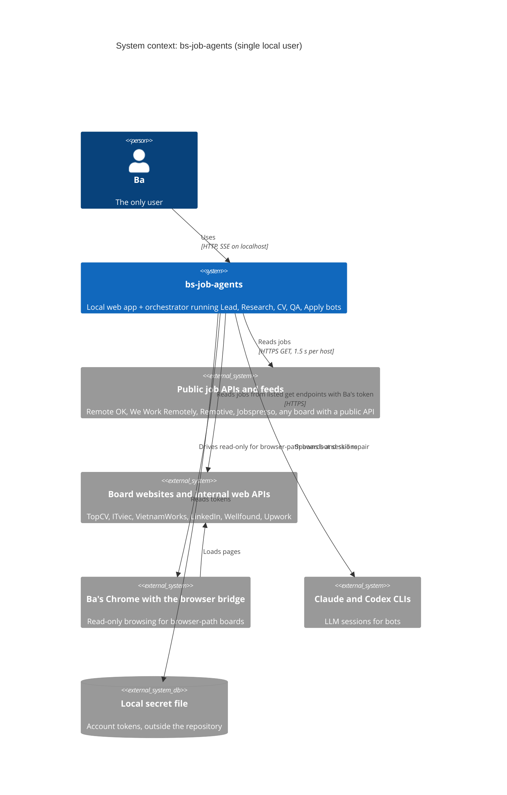
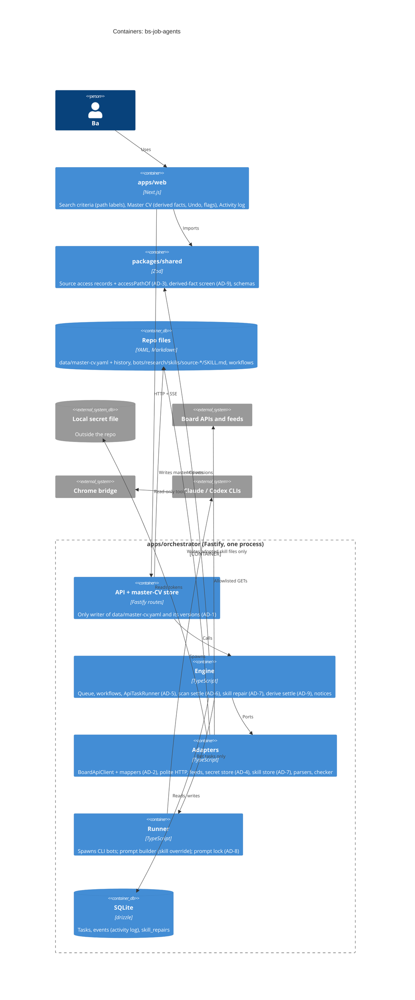

# Architecture: job research without the browser extension, self-updating skills and CV

Run r20261017-044722, depth M. Inputs: `.vtc/spec/spec.md` (revision 2) and
`.vtc/research/repo-map/repo-map.md`. No research brief, fact rows or threat model were in the task
pack. The binding decisions are in `.vtc/architecture/spine.md` (AD-1 to AD-9).

## 1. Recommendation

Candidate A: keep the existing modular monolith and extend it in place. The orchestrator itself
reads every board that has a public or internal web API (generalising today's no-LLM feed path),
through one allowlisted, polite HTTP client. Account tokens come from a local secret file outside the
repository and never reach a bot. Skill repair is an engine flow (draft, validate, adopt) that can
only write skill files. Derived facts come from a tool-less `cv.derive` step, are checked by a pure
screen in `packages/shared`, and are saved through the existing versioned, undoable master-CV path.
No new package, service, datastore or runtime: 0 innovation tokens.

## 2. Driving scenarios

Ranked by importance times difficulty (H=3, M=2, L=1).

| Id | Source and stimulus | Environment | Response | Measure | Imp x Diff |
| --- | --- | --- | --- | --- | --- |
| S1 Read-only | A scan of a board on the account API path, any number of runs | Normal operation, Ba's account token in use | Only the record's get endpoints are requested | 0 requests to endpoints not listed as get endpoints; 0 apply-endpoint requests (REQ-23.AC-1/AC-2, NG7) | 3 x 3 = 9 |
| S2 Token secrecy | A scan runs with, without, or with a rejected token | Token in local secret storage; a token-like value in a repo file | The token is read only from secret storage and appears nowhere else | 0 occurrences of the token value in prompts, transcripts, events, notices, logs; repo value never used (REQ-24, REQ-5, REQ-25) | 3 x 3 = 9 |
| S3 CV integrity | `cv.derive` drafts a derived fact | Any JD, any master facts | Unsupported numbers, years, durations, employers, titles are rejected | 100% of the REQ-27 and REQ-28 table cases rejected or accepted as specified; 0 derived facts without a citation (REQ-15) | 3 x 3 = 9 |
| S4 Safe self-repair | A browser scan fails as "adapter broken" | Board layout changed | One repair drafts, validates and adopts a skill, or keeps the old one | 1 attempt per source at a time; 0 files changed outside `bots/research/skills/source-<s>/`; 0 degraded starts (REQ-8, REQ-9, REQ-12, REQ-13) | 3 x 2 = 6 |
| S5 Fault isolation | One board fails (missing token, 401, 503 on every try) | Multi-source scan | Only that branch fails, with a notice | Other branches complete in 100% of the REQ-5/REQ-6 cases; 401/403 retried 0 times | 2 x 2 = 4 |
| S6 Politeness | A scan sends several requests to one host | Non-browser path | Requests are spaced | Every gap of at least 1500 ms (NFR-1) | 2 x 1 = 2 |
| S7 Board API drift | A board changes its internal API response shape | After adoption | The change is confined | 1 mapper file changes per drifted board (repair of API paths is out of scope, spec section 9) | 1 x 2 = 2 |

S1 to S4 drive the decision. No latency, availability or cost target is set (spec NFR section, OQ-6).

## 3. Constraints applied as filters

- Existing system is the baseline (pnpm/Turborepo, TypeScript, Fastify orchestrator with SQLite via
  drizzle, Next.js web, Zod in `packages/shared`, bots on the Claude and Codex CLIs; repo map).
- Out of scope filters out: any state-changing request (NG1, NG7), automatic edits to `ROLE.md`,
  `bot.json`, workflows or allowed sites (NG5), changes to `ResearchScanOutput`, fit or dedupe (NG3).
- Single local user: no multi-tenant or remote secret manager is considered.
- No team-default stack file or banned list was supplied; no licence or budget filter applies
  beyond "add nothing new".

## 4. Candidates

- **A (baseline, recommended):** orchestrator-fetched non-browser paths (`ApiTaskRunner` absorbing
  `engine/feed-tasks.ts`), per-board response mappers behind one `BoardApiClient`, a file secret
  store behind a port, engine-driven skill repair, a `cv.derive` step with a pure screen.
- **B (smallest change aimed at S7 and the request's "MCP"):** as A, but account and public API
  boards are read by the Research bot through an orchestrator-hosted MCP tool `board_api_get`
  (allowlist and token kept server-side), and the bot maps the JSON to `ResearchScanOutput`.
  Spec A7 allows this. Skill repair, secrets and derived facts are the same as A.
- No candidate C: no driver needs a new service, queue or datastore.

## 5. Scorecard

Scores 1 to 5 (5 best); weight 1 to 5.

| Criterion (scenario) | Weight | A | B | Why |
| --- | --- | --- | --- | --- |
| Read-only (S1) | 5 | 5 | 4 | A: requests are code, checked by one allowlist. B: same allowlist, but an LLM chooses the parameters, and text inside job postings can steer it within the allowlist. |
| Token secrecy (S2) | 5 | 5 | 4 | A: the token and account responses stay in the orchestrator process. B: the token stays server-side, but account-scoped responses enter an LLM context and its transcript. |
| Fault isolation (S5) | 3 | 5 | 4 | A: deterministic errors (missing token, 401, 503) map straight to branch failures. B: adds CLI session failures and usage pauses on top. |
| Politeness (S6) | 3 | 5 | 5 | Both use the same per-host gate. |
| Board API drift (S7) | 2 | 2 | 4 | A: a renamed field is a code change to one mapper. B: the model tolerates small shape changes. |
| Team skills | 2 | 5 | 4 | A extends `FeedTaskRunner` and the feed adapters already in the repo. B needs a new bot-facing MCP server (only Figma exists for bots). |
| 12-month cost (S1, S5) | 3 | 5 | 2 | A: no LLM call per API scan. B: one Research session per board per scan, from Ba's Claude/Codex quota. |
| Operational burden (S5) | 3 | 4 | 3 | B adds an MCP server lifecycle per run and quota pauses. |
| Reversibility (S7) | 2 | 4 | 4 | Both put the path choice behind `accessPathOf`; A can add B's MCP tool later without undoing anything. |
| New technologies (budget 0 to 1) | 2 | 5 | 4 | A: 0 tokens. B: 0 packages, but a new pattern (bot-facing board MCP). |
| **Weighted total** | 30 | **139** | **114** | |

S3 and S4 score the same for A and B (same derive and repair design), so they are left out of the
table instead of being scored twice.

**Robustness:** moving any single weight by one point changes the 25-point gap by at most 3 (S7 +1: A 141,
B 118; cost -1: A 134, B 112). The winner does not change: **not a close call.** B would win only if
S7 outweighed S1 and S2 together, which the spec rules out by keeping API-path repair out of scope.

## 6. New technologies used

None. The board-API client uses the injected `fetch` the feed adapters already use; secrets use a
JSON file and Node's file system; the new tables use the existing SQLite and drizzle migrations.

## 7. Components

| Id | Component | Where | Responsibility |
| --- | --- | --- | --- |
| C1 | Source access catalogue | `packages/shared/src/source-access/**`, `packages/shared/src/common/sources.ts` | Per-board access records (REQ-22), `accessPathOf` (REQ-21, NFR-2) |
| C2 | API task runner | `apps/orchestrator/src/engine/api-tasks.ts` (absorbs `feed-tasks.ts`), `db/repos/tasks.ts` claim filter | Runs public-API and account-API scans without a bot |
| C3 | Board API client and mappers | `apps/orchestrator/src/adapters/board-api/**`, `adapters/feeds/**` | Allowlisted get requests; maps responses to `ResearchScanOutput` |
| C4 | Polite HTTP | `apps/orchestrator/src/adapters/http/**` | Per-host 1500 ms gap, timeouts, transient vs auth error classes |
| C5 | Secret store | `engine/ports.ts` `SecretStore`, `apps/orchestrator/src/adapters/secrets/**`, `config.ts` | Tokens from a local file outside the repo; redaction |
| C6 | Scan settle pipeline | `apps/orchestrator/src/engine/scan-settle.ts`, `scan-check.ts`, `adapters/checker.ts`, `db/dedupe.ts` | Same validation, self-check, checker, dedupe for every path |
| C7 | Research bot, browser path (existing) | `bots/research/**`, `runner/**`, `bridges/chrome/site-guard/**` | Browser scans with source skills; repair drafts (`research.repair`) |
| C8 | Skill repair | `apps/orchestrator/src/engine/skill-repair.ts`, `skill_repairs` table, `runner/prompt.ts` override | Single-flight draft, validate, adopt; events |
| C9 | Skill store | `apps/orchestrator/src/adapters/skill-store/**` | The only writer of `bots/research/skills/source-*/SKILL.md` |
| C10 | Prompt-version lock (existing) | `runner/prompt-lock.ts`, `bots/prompt-versions.json` | Guards ROLE.md only; skills stay outside |
| C11 | Derive step | `workflows/job-scan.yaml` `derive` step, `bots/cv` kind `derive`, `apps/orchestrator/src/engine/derive.ts` | Drafts derived facts per job before tailoring |
| C12 | Derived-fact screen | `packages/shared/src/bots/derive.ts` | Pure checks: citations, numbers, years, durations, employers, titles |
| C13 | Master CV store | `apps/orchestrator/src/api/master-cv.ts`, `api/derived-facts.ts`, `api/fact-drafts.ts`, `api/routes/master-cv.ts`, `packages/shared/src/domain/master-cv.ts` | Versioned writes with Undo; `derived` provenance; source-changed flagging |
| C14 | Notices and activity log | `apps/orchestrator/src/engine/notices.ts`, events table | Branch failure, token, repair notices; repair log entries |
| C15 | Web screens | `apps/web` Search criteria, Master CV, Activity log | Path labels; "Added automatically", "Implied from", Undo, "Source fact changed"; repair entries |
| C16 | CV tailor (existing) | `bots/cv` kind `tailor`, `engine/inputs.ts` | Tailors from the current master version; raises fact requests as today |

## 8. Requirement-to-component map

| Requirement | Components | Decisions |
| --- | --- | --- |
| REQ-1 | C2, C3, C6 | AD-5, AD-6 |
| REQ-2 | C2, C1 | AD-5, AD-3 |
| REQ-3 | C6 | AD-6 |
| REQ-4 | C1, C7 | AD-3 |
| REQ-5 | C2, C5, C14 | AD-4, AD-5 |
| REQ-6 | C2, C4, C14 | AD-2, AD-5 |
| REQ-7 | C1, C15 | AD-3 |
| REQ-8 | C8, C7 | AD-7 |
| REQ-9 | C8, C6, C7 | AD-7 |
| REQ-10 | C8, C14 | AD-7 |
| REQ-11 | C8, C14, C15 | AD-7 |
| REQ-12 | C10, C8 | AD-8 |
| REQ-13 | C9, C8 | AD-7 |
| REQ-14 | C11, C12, C13, C16 | AD-9, AD-1 |
| REQ-15 | C12, C13 | AD-1, AD-9 |
| REQ-16 (removed in r2; rule continues as REQ-27, REQ-28) | C12 | AD-9 |
| REQ-17 | C11, C16 | AD-9 |
| REQ-18 | C13, C15 | AD-1 |
| REQ-19 | C13, C15 | AD-1 |
| REQ-20 | C13, C15, C11 | AD-1 |
| REQ-21 | C1 | AD-3 |
| REQ-22 | C1 | AD-3 |
| REQ-23 | C3 | AD-2 |
| REQ-24 | C5, C3 | AD-4 |
| REQ-25 | C5, C2, C14 | AD-4, AD-5 |
| REQ-26 | C11, C12, C13 | AD-9, AD-1 |
| REQ-27 | C12 | AD-9 |
| REQ-28 | C12 | AD-9 |
| NFR-1 | C4 | AD-2 |
| NFR-2 | C1 | AD-3 |

Component to decisions: C1 AD-3; C2 AD-5, AD-6; C3 AD-2, AD-4; C4 AD-2; C5 AD-4; C6 AD-6;
C7 AD-7 (unchanged tool grant and site guard); C8 AD-7; C9 AD-7; C10 AD-8; C11 AD-9; C12 AD-9,
AD-3 (shared stays pure); C13 AD-1; C14 AD-4 (redaction), AD-7; C15 AD-1, AD-3; C16 AD-9.

No SEC-n ids exist (no threat model in the pack).

## 9. C4 diagrams

### Level 1: system context

### Level 2: containers

## 10. Key flows

- **API scan:** map step creates `research.scan` per source; the queue routes it by
  `accessPathOf`; `ApiTaskRunner` reads the token (account path), calls the mapper through
  `BoardApiClient`, and settles through `settleScanOutput`; join, dedupe, fit and the rest of
  `job-scan.yaml` are unchanged.
- **Skill repair:** scan settle marks "adapter broken" on a browser source; in the same
  transaction `skill-repair` inserts the single active row and queues `research.repair`; the draft
  is screened, a validation scan runs with the draft injected; adopt or not; one event; on failure
  the two notices of REQ-10.
- **Derive:** per job, `cv.derive` (tool-less) drafts; `screenDerivedFacts` filters; accepted
  facts become master version N+1 with Undo; `tailor` reads version N+1; uncovered requirements
  become fact requests.

## 11. Risks, red flags and open points

- **No threat model in the pack.** Security requirements (SEC-n) were expected from it (spec NFR
  section). AD-2, AD-4 and AD-7 carry the security rules this design needs; a threat model may add
  SEC-n ids to map at a later round.
- **Persisted prompt injection through skill repair.** A repair draft is written by a bot that read
  board pages; a hostile page could plant instructions in the adopted skill. Mitigations in AD-7:
  validation scan, host screen, size limit, unchanged tool grant and site guard, full diff in the
  activity log. OQ-3 (Ba reverting a repair) would add a human undo; not decided here.
- **Account risk (OQ-11).** AD-3 enforces only "documented terms and risk"; whether a high-risk
  board (for example LinkedIn) needs Ba's per-board approval is still open.
- **"Well-known implication" (OQ-10)** stays model judgement, recorded per fact as `relation` and
  `rationale`; the screen cannot check it, only the invented details around it.
- **REQ-28 title detection** in free text is heuristic (titles known from master facts); a title the
  screen does not know cannot be caught deterministically.
- **Hard-to-reverse choices:** the `derived` block in `data/master-cv.yaml` (AD-1) is additive and
  optional, so older files still parse; the `skill_repairs` table is new and isolated.
- Research red flags: none (no fetched source was in the inputs).
- UNVERIFIED claims: none. This document states no version, licence, support window,
  vulnerability or price.

## 12. Cost estimate and assumptions

- Infrastructure: none added; runs on Ba's machine as today.
- LLM quota: API-path scans spend none (today's feed sources already work this way); each tailored
  job adds one tool-less `cv.derive` call; each adapter-broken incident adds one `research.repair`
  and one validation scan. No price is given (OQ-6 sets no budget).
- Assumptions: spec A1 to A9 hold as written; access records are filled by the research task of
  this run before any board switches off the browser path (until then `accessPathOf` returns
  `browser` for the six boards); task-level retry under the existing `maxAttempts` satisfies REQ-6
  (OQ-6 may set a different cap).
