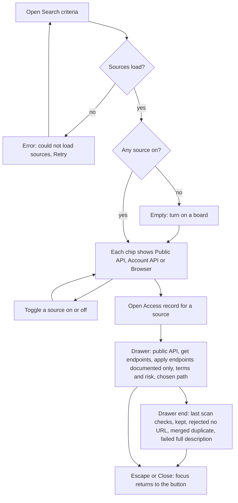
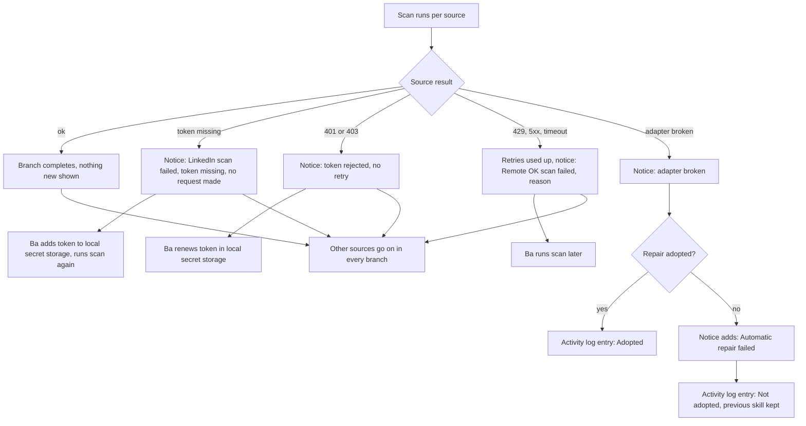
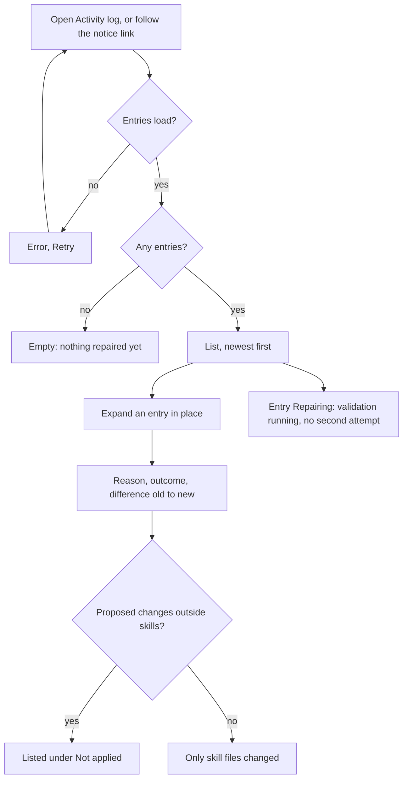
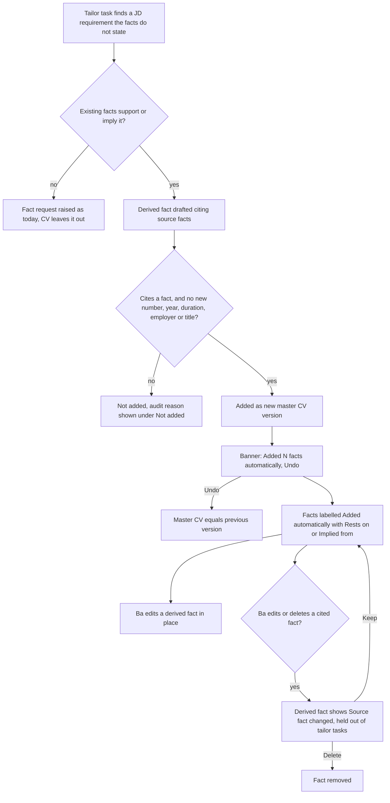

# Flows

Every path through the user-facing requirements, including failure and permission branches. There is no permission branch: one local user (specification section 6).

## 1. Choose and check how each board is read (REQ-1, 2, 3, 4, 7, 21 to 24)

## 2. A scan reports a failure (REQ-5, 6, 10, 25)

## 3. Review an automatic skill repair (REQ-8, 9, 11, 12, 13)

## 4. The system extends the master CV (REQ-14 to 20, 26 to 28)

